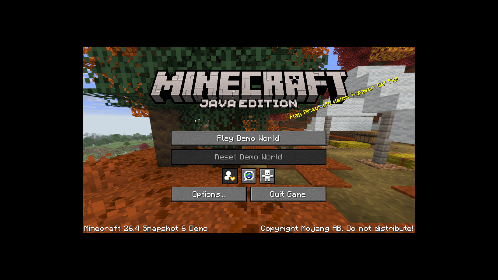

# Switchcraft — 26.4-snapshot-6 / Vulkan

`main` targets **Minecraft 26.4-snapshot-6, Java 25 and Vulkan**. The previous
OpenGL/Java-8 research baseline is preserved on branch
[`legacy/1.12.2`](https://github.com/a1c7e0/switchcraft/tree/legacy/1.12.2).
Java runtime work now lives in
[`java-switch`](https://github.com/a1c7e0/java-switch), consumed at an immutable
commit from `dependencies.lock.json`.

GitHub's default branch is `main`. Use `legacy/1.12.2` for the preserved older
implementation.

**The snapshot reaches its title screen in the Linux Java-25/Vulkan reference.
R2 physical logs confirm the Java 8 diagnostic, private memory probe and
300-frame Vulkan presentation pass. Java 25 fails during heap initialization;
R3 fixes the rejected guard-page operation and protects early crash reporting.
The R3 changes still require physical testing. Java 25 execution and the
Minecraft title on Switch are not established.**

The reference uses the official Demo mode, no account credentials, and Mesa
llvmpipe Vulkan. The image below is **HOST ONLY**, not a Switch screenshot:



## Implemented and built

The [launcher](docs/PRISM_PORT.md) provides a controller/touch UI and a portable
Prism instance/component backend. It supports creation/editing, settings-only
duplication, online version catalogs, verified installation/repair, integrity
checks, folder import and archive/restore. It is included in the R3
device test package; no separate overlay is needed. Follow
[the launcher tests](docs/LAUNCHER_TESTS.md). Account flows, mod
management and the full Qt framework are not ported. The UI is cross-built and
host-tested; Horizon UI/network execution remains NOT TESTED.

| Artifact | Actual behavior |
| --- | --- |
| `switch-diagnostics.nro` | Input, SD roundtrip, process/malloc memory, native threads and next-load navigation |
| `vulkan-test.nro` | NVK enumeration, transfer/readback, offscreen triangle |
| `vulkan-present.nro` | Exact snapshot-6 base-feature capture; SDL3 window/gamepad, VI surface, swapchain and presentation loop |
| `minecraft-launcher.nro` | Prism instances, controller/touch UI, verified online installation/repair, import/archive and honest Java-25 launch status |
| `java-test.nro` | Independent java-switch Java-8 interpreter diagnostic; this is not a Java-25 VM |
| `ffi-test.nro` | AAPCS64 downcalls, libnx RW/RX upcall closures and whole-region virtual-memory probe |
| `zero-services-test.nro` | Independent native VM service probes; no VM |
| `java25-test.nro` | Genuine Zero VM with Hello, JNI/FFM and startup-agent actions; hardware untested |
| `switchcraft-java25.nro` | Genuine VM and composed JDK/SDL/Vulkan resolver; Hello and Java JNI/FFM SDL version attempts; hardware untested |
| `switchcraft-lwjgl-horizon.jar` | Horizon platform identity and JNI load dispatch; native FFM SharedLibrary remains unavailable |
| `switchcraft-launcher-bridge.jar` | Hash-pinned renderer-method transformation; one Vulkan backend, no OpenGL fallback; host tested |

SDL3 is built without EGL, OpenGL or OpenGL ES. Its Switch port's unconditional
EGL dependency was fixed in `patches/sdl3-vulkan-only.patch`. The original client
still contains an OpenGL fallback; the bundled Java transformation restricts
that single renderer-selection method without modifying authentication code.
No Minecraft class bytes, assets, native desktop libraries or account data are
redistributed. The bridge requires Java 25 and `java.instrument`, cross-built
in the pinned runtime image; Horizon startup/instrumentation are NOT TESTED.

## Build and install

For physical testing, download the single
[R3 SD test ZIP](https://github.com/a1c7e0/switchcraft/releases/download/test-suite-2026-11-09-r3/switchcraft-test-suite-2026-11-09-r3.zip).
Extract it directly into the SD root. It contains only `switch/`, compact
instructions and a manifest; matching source and debug symbols are separate
optional release downloads. No part assembly or overlay is required. Follow
[SD_TEST_PACKAGE.md](docs/SD_TEST_PACKAGE.md) and START_HERE.md; preserve personal
configuration, saves and logs. See [the R2 physical feedback](docs/DEVICE_FEEDBACK_2026_11_09.md)
for the failure reproduced by this update.

```sh
bash scripts/build-all.sh
```

Linux x86_64, Python 3.12+, GCC/G++, Make, patch, Git and HTTPS access are required.
The toolchain image, NVK archive, SDL3 source, host CMake wheel and Java repository
revision are pinned. Access to the pinned `java-switch` repository is required.
The toolchain and hash-verified caches can be reused; no root installation is
needed. See [BUILD.md](docs/BUILD.md).

The pipeline builds nine real NROs, tests the native/Java boundaries on the host,
verifies AArch64/NRO/ASET/NACP/build IDs and creates:

* `dist/switch-minecraft-test-package.zip` and `dist/COPY_TO_SD/`
* `dist/switchcraft-corresponding-source.tar.gz`
* `dist/manifest.json`, `dist/SHA256SUMS` and `dist/DELIVERY_REPORT.md`
* `dist/switchcraft-debug-symbols.zip` and `dist/switchcraft-native-sdk.tar.gz`

`python3 scripts/package-device-slim.py` creates the smaller user-facing SD ZIP
from the verified build. Source and debug archives remain separate release assets.

Merge the package onto the SD root and preserve existing saves/configuration.
Use **application-mode hbmenu** under Atmosphère on Switch 1. Start native
memory/SD/thread tests, then `vulkan-present` A for feature capture and X for
SDL3/VI presentation; then NVK offscreen and FFI tests. The detailed
[TEST_PLAN.md](docs/TEST_PLAN.md) defines independent cases and recovery steps.
For the first physical session, use the shorter
[device checklist](docs/DEVICE_TEST_QUICKSTART.md) for controls, pass markers
and per-attempt log collection.
No kernel patches, overclocking, Linux/Android installation or remote game
execution are required by the NROs.

Use the launcher's Versions > Install / repair action, or copy a legitimately
obtained installation's `versions/`, `libraries/` and `assets/` to
`sdmc:/minecraft/.minecraft`. Settings selects the shared installation root.
Runtime settings/logs remain under `sdmc:/switch/mc-runtime`. Integrity checks and
plan generation are read-only; explicit install/repair manages downloaded cache
resources. Existing configuration is preserved until Save preferences. The
base-package console inspector uses its original controls documented in the
device checklist.

## Validation and remaining work

The main host suite tests metadata, artifact rejection, strict renderer behavior
and profile gates. The independent runtime suite tests Java 8 and actual host
Java 25 JNI creation/native registration/FFM downcalls/upcalls/teardown.
The baseline SDK and minecraft-launcher remain VM-free and report
`runtime-not-linked`. Separate experimental NROs link the genuine VM; their
availability query proves symbol presence, not startup. The game launch remains
blocked on tested VM execution and LWJGL/FFM/native bindings. Earlier physical
results came from the B7 package and are historical, not R2 verification. R2
fixes the Java 8 file-path diagnostic, adds a real private-memory fallback and
retained Java fatal diagnostics; these changes still need new device runs. See
the [device evidence summary](docs/evidence/device-2026-11-08/summary.json) and
[test plan](docs/TEST_PLAN.md). Horizon VM startup and Minecraft title remain
unestablished.

To reproduce the host reference, prepare a Linux X11/Vulkan environment and run:

```sh
python3 tools/snapshot6-reference.py --download-assets
python3 tools/snapshot6-reference.py --run-demo
```

This downloads official game files into ignored `.cache/`, validates hashes,
uses the built-in Demo mode and logs the actual renderer. It is a host reference,
not a proposed way to execute the Switch game on another computer. See
[HOST_REFERENCE.md](docs/HOST_REFERENCE.md) for exact evidence and limitations.

* [Architecture and diagram](docs/ARCHITECTURE.md)
* [Upstream research](docs/UPSTREAM_RESEARCH.md)
* [Status and evidence](docs/IMPLEMENTATION_STATUS.md)
* [Compatibility](docs/COMPATIBILITY.md)
* [Known issues](docs/KNOWN_ISSUES.md)
* [Decisions](docs/DECISIONS.md) and [next steps](docs/NEXT_STEPS.md)
* [Java SDK handoff](docs/JAVA_INTEGRATION_HANDOFF.md) and [native bindings](docs/NATIVE_BINDINGS.md)

Original source is MIT. The combined launcher now incorporates GPL-covered Prism
code and is distributed under GPL-3.0-only with the applicable Apache-2.0 notices;
see [the port/source notes](docs/PRISM_PORT.md#licensing-and-source). Third-party
notices and the full miniJVM Java/C and
libffi source accompany distributions. The Java class library retains GPL terms;
binary-only redistribution does not remove source obligations.
