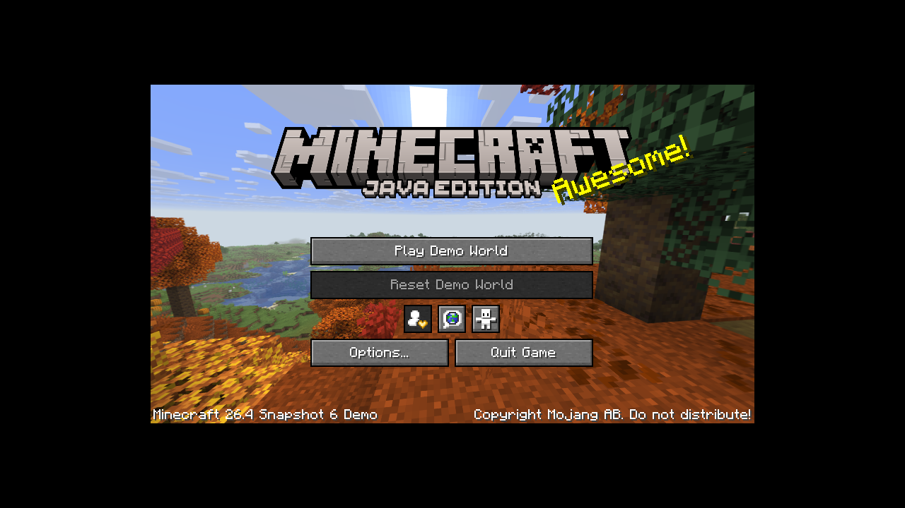

# Switchcraft — 26.4-snapshot-6 / Vulkan

`main` targets **Minecraft 26.4-snapshot-6, Java 25 and Vulkan**. The previous
OpenGL/Java-8 research baseline is preserved on branch
[`1.12.2`](https://github.com/a1c7e0/switchcraft/tree/1.12.2). Java runtime work
now lives in [`java-switch`](https://github.com/a1c7e0/java-switch), consumed at
an immutable commit from `dependencies.lock.json`.

**The snapshot reaches its title screen in the Linux Java-25/Vulkan reference.
It does not yet run on Horizon: a native Java 25 VM is not built or linked.
All Switch hardware execution is NOT TESTED.**

The reference uses the official Demo mode, no account credentials, and Mesa
llvmpipe Vulkan. The image below is **HOST ONLY**, not a Switch screenshot:



## Implemented and built

| Artifact | Actual behavior |
| --- | --- |
| `switch-diagnostics.nro` | Input, SD roundtrip, process/malloc memory, native threads and next-load navigation |
| `vulkan-test.nro` | NVK enumeration, transfer/readback, offscreen triangle |
| `vulkan-present.nro` | Exact snapshot-6 base-feature capture; SDL3 window/gamepad, VI surface, swapchain and presentation loop |
| `minecraft-launcher.nro` | Read-only version/inheritance/dependency planning, strict Vulkan JVM/game arguments, saved configuration and honest Java-25 launch gate |
| `java-test.nro` | Independent java-switch Java-8 interpreter diagnostic; this is not a Java-25 VM |
| `ffi-test.nro` | AAPCS64 libffi downcalls and real libnx RW/RX upcall closures, prerequisites for Zero's fallback FFM linker |
| `switchcraft-launcher-bridge.jar` | Hash-pinned renderer-method transformation; one Vulkan backend, no OpenGL fallback; host tested |

SDL3 is built without EGL, OpenGL or OpenGL ES. Its Switch port's unconditional
EGL dependency was fixed in `patches/sdl3-vulkan-only.patch`. The original client
still contains an OpenGL fallback; the bundled Java transformation restricts
that single renderer-selection method without modifying authentication code.
No Minecraft class bytes, assets, native desktop libraries or account data are
redistributed. The bridge requires Java 25 and `java.instrument`, unavailable
on Horizon until the VM port is completed.

## Build and install

```sh
bash scripts/build-all.sh
```

Linux x86_64, Python 3.12+, GCC/G++, Make, patch, Git and HTTPS access are required.
The toolchain image, NVK archive, SDL3 source, host CMake wheel and Java repository
revision are pinned. Access to the private `java-switch` repository is required.
The toolchain and hash-verified caches can be reused; no root installation is
needed. See [BUILD.md](docs/BUILD.md).

The pipeline builds six real NROs, tests the native/Java boundaries on the host,
verifies AArch64/NRO/ASET/NACP/build IDs and creates:

* `dist/switch-minecraft-test-package.zip` and `dist/COPY_TO_SD/`
* `dist/switchcraft-corresponding-source.tar.gz`
* `dist/manifest.json`, `dist/SHA256SUMS` and `dist/DELIVERY_REPORT.md`

Merge the package onto the SD root and preserve existing saves/configuration.
Use **application-mode hbmenu** under Atmosphère on Switch 1. Start native
memory/SD/thread tests, then `vulkan-present` A for feature capture and X for
SDL3/VI presentation; then NVK offscreen and FFI tests. The detailed
[TEST_PLAN.md](docs/TEST_PLAN.md) defines independent cases and recovery steps.
No kernel patches, overclocking, Linux/Android installation or remote game
execution are required by the NROs.

Copy a legitimately obtained installation's `versions/`, `libraries/` and
`assets/` to `sdmc:/minecraft/.minecraft`, or configure another root. Runtime
settings/logs remain under `sdmc:/switch/mc-runtime`; the installation is read
only. Copy `launcher.example.json` to `launcher.json` to configure a root, or
save in the launcher. Legacy graphics choices are migrated in memory to Vulkan;
existing configuration is written only on explicit X/save.

## Validation and remaining work

The main host suite tests metadata, artifact rejection, strict renderer behavior
and profile gates. The independent runtime suite tests Java 8 and actual host
Java 25 JNI creation/native registration/FFM downcalls/upcalls/teardown.
The same JNI adapter is compiled into the Horizon SDK, where it reports
`runtime-not-linked` because no Java 25 VM exists. No UI claims it can launch a
game on Switch. OpenJDK 25 configuration actually fails on unsupported Horizon
OS detection; real memory/fault/thread/class-library and static JNI/FFM module
work is still needed. Linked Vulkan/SDL/FFI code awaits physical execution.

To reproduce the host reference, prepare a Linux X11/Vulkan environment and run:

```sh
python3 tools/snapshot6-reference.py --download-assets
python3 tools/snapshot6-reference.py --run-demo
```

This downloads official game files into ignored `.cache/`, validates hashes,
uses the built-in Demo mode and logs the actual renderer. It is a host reference,
not a proposed way to execute the Switch game on another computer. See
[HOST_REFERENCE.md](docs/HOST_REFERENCE.md) for exact evidence and limitations.

* [Architecture and diagram](docs/ARCHITECTURE.md)
* [Upstream research](docs/UPSTREAM_RESEARCH.md)
* [Status and evidence](docs/IMPLEMENTATION_STATUS.md)
* [Compatibility](docs/COMPATIBILITY.md)
* [Known issues](docs/KNOWN_ISSUES.md)
* [Decisions](docs/DECISIONS.md) and [next steps](docs/NEXT_STEPS.md)

Original source is MIT. Third-party notices and the full miniJVM Java/C and
libffi source accompany distributions. The Java class library retains GPL terms;
binary-only redistribution does not remove source obligations.
