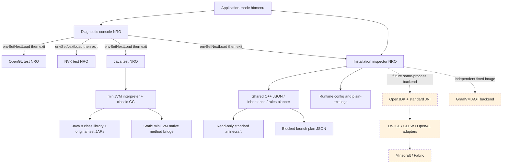
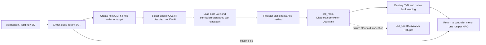
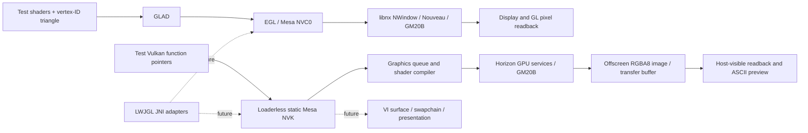
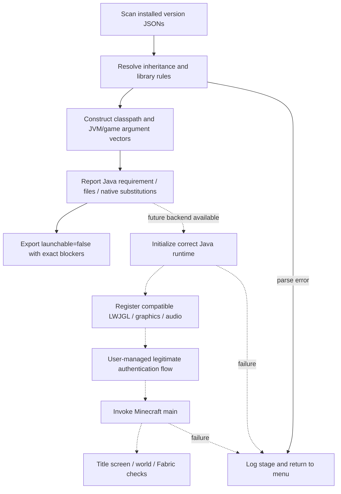

# Architecture

Solid nodes/edges below represent implemented source and linked components.
Dashed nodes/edges are planned integrations. All Horizon nodes remain hardware
NOT TESTED. The standalone [architecture.svg](architecture.svg) uses the same
distinction and can be viewed without Mermaid support.

## Components and process boundaries



The applications are separate NROs so independent GPU/JVM failures do not remove
the platform diagnostic. Next-load requests replace the current application
through hbmenu; they are not Linux fork/exec or concurrent processes. A future
launcher/game runtime should enter the JVM in the same NRO or define an explicit
serialized handoff, rather than retaining a launcher process beside the game.

`platform.c/.h` owns Horizon services. `metadata.cpp/.hpp` is portable and shared
by the host inspector and native launcher. `java_vm.c` isolates miniJVM's own
integer typedefs/ABI from libnx headers; `java_test.c` owns platform initialization.
The runtime boundary is the native adapter, not a claimed drop-in JNI library.

## Java initialization and recovery



The host runs the same diagnostic adapter/interpreter, but POSIX host behavior
does not prove Horizon pthread/TLS, Java I/O or teardown. The OpenJDK candidate
needs missing platform services (mmap-style memory, executable code aliasing,
signals/exceptions, TLS, dynamic native registration, threads, class libraries)
before a real Invocation API can be tested. Interpreter-only miniJVM avoids JIT
executable-memory requirements at substantial expected performance cost; no
Minecraft frame rate is inferred.

## OpenGL and Vulkan paths



OpenGL and Vulkan never share driver globals in one NRO. The OpenGL test releases
the console renderer before creating an EGL window/context, reports API data,
draws/reads pixels and restores console UI after teardown. NVK keeps the console
renderer and tests independent headless GPU resources. Its device/extension/heap
report is evidence to collect, not a promise of modern Minecraft compatibility.
Zink is a future alternative, not a linked backend.

## Filesystem layout

```text
sdmc:/switch/<application>/<application>.nro
sdmc:/switch/mc-runtime/
  config/launcher.json             # user-created or saved by inspector
  config/launcher.example.json     # package never overwrites real settings
  logs/<application>.log           # flushed append-only diagnostic logs
  logs/launch-plan.json            # last read-only inspection plan
  runtimes/minijvm/minijvm_rt.jar
  tests/{diagnostic-tests,dependency,user}.jar
  instances/java-smoke/            # actual Java test I/O
  instances/test/<version>/        # future isolated game directory
  licenses/
sdmc:/minecraft/.minecraft/
  versions/ libraries/ assets/ mods/ config/ saves/ resourcepacks/ shaderpacks/
```

Standard installations remain recognizable. No PC native library is extracted
or executed by the inspector. Inherited manifests resolve parent JARs, override
Maven library coordinates, append structured arguments and apply Horizon rules.
Asset indexes are counted; missing files and native substitutions are reported.
Authentication placeholders stay unresolved. Logs/plans do not acquire tokens.

## Minecraft startup and failure flow



The independent host experiment reached Minecraft 1.12.2 main-class loading but
failed on missing class-library/native methods. The Horizon inspector stops at
BLOCK. Native allocation failures, `Result`/`VkResult`/EGL/GL errors and stages
are logged. Driver-level hangs and Java fatal failures may require HOME/relaunch;
an in-process crash recovery guarantee is not implemented.
