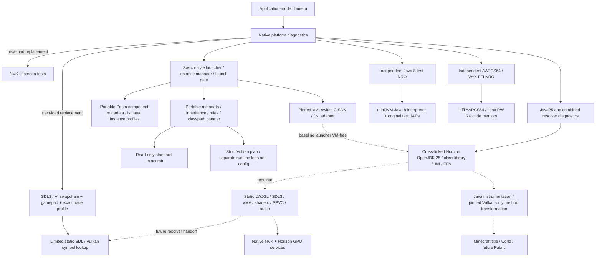
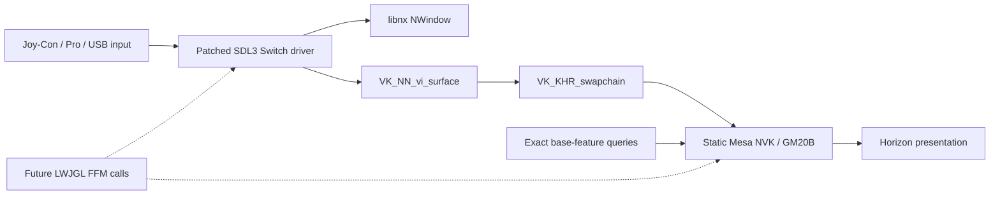
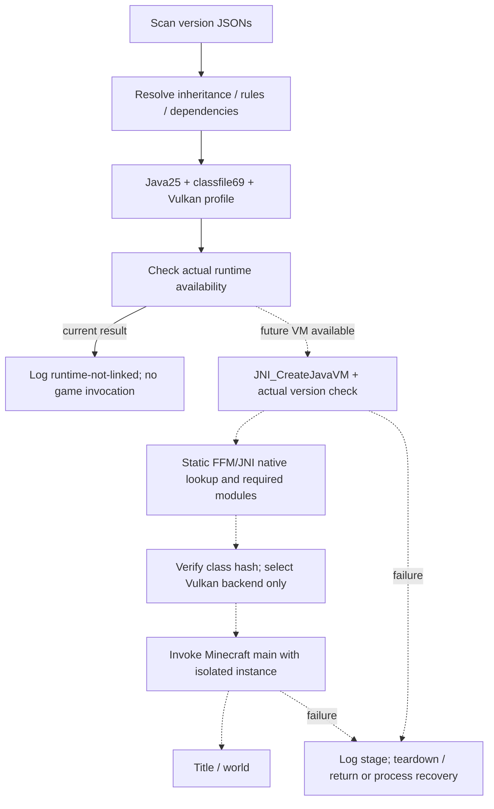

# Mainline architecture — snapshot 6 / Vulkan

Solid paths have implemented and compiled code. Dashed paths are unavailable
runtime integration. **Every Horizon path is hardware NOT TESTED.** Host reference
execution is separate and is not a Switch execution backend.



`java-switch` owns JVM adapters, interpreter, original Java workloads, SDK and
libffi code. This repository consumes a fixed commit, builds/repacks its NROs and
links its SDK. `src/platform.c` owns Horizon console/input/SD/memory/threads;
`metadata.cpp` is shared with host tools; `vulkan_present.c` owns SDL/VI behavior.

The Minecraft launcher remains VM-free and returns JS_UNAVAILABLE/runtime-not-linked.
Separate Java25 diagnostics link the actual VM in-process; VM startup, the
composed provider and all Java execution remain untested on Horizon. No Play
action claims Minecraft is ready. The diagnostics terminate their application
process after a VM session; there is no fork/exec or VM reuse in the loader.

## Graphics path



SDL3 is configured with GL/OpenGL ES/EGL disabled. Its native Switch backend
previously referenced EGL even for Vulkan windows; the patch guards/removes
those dependencies. Native linked symbol checks contain SDL/Vulkan entries and
no EGL/OpenGL API functions. This does not prove Java bindings or hardware output.

Presentation uses a graphics/present queue, actual surface capabilities/formats,
FIFO, per-image render-finished semaphores, finite acquire/fence waits and a
conservative queue drain. It clears animated colors over up to 300 frames and
records SDL gamepad events. The independent NVK NRO retains transfer/readback and
a shader-rendered offscreen triangle. Driver hangs remain possible.

## Runtime and startup



The SDK's JNI creation/options/native-registration/teardown and FFM tests pass
against a real **host** Java 25 VM. The independent Horizon Zero VM, native
providers and java.base/java.instrument image are cross-built; no physical VM
startup is established. Unsupported OS services remain explicit failures.

The strict renderer bridge uses Java 25's public Class-File API/instrumentation
and checks the exact original renderer-class hash. It modifies only backend
selection. It preserves the normal loader and all authentication code. Its JAR
contains original source-generated code, not game class bytes.

## Filesystem and failure boundaries

```text
sdmc:/switch/{switch-diagnostics,vulkan-test,vulkan-present,minecraft-launcher,java-test,ffi-test,zero-services-test,java25-test,switchcraft-java25}/<name>.nro
sdmc:/switch/mc-runtime/
  config/{launcher.example.json,launcher.json}
  logs/{<application>.log,launch-plan.json,snapshot-vulkan.json}
  profiles/26.4-snapshot-6.json
  launchers/{switchcraft-launcher-bridge,switchcraft-lwjgl-horizon}.jar
  runtimes/openjdk25/{lib/modules,conf,legal,...}
  runtimes/minijvm/minijvm_rt.jar
  tests/{diagnostic-tests,dependency,java25-tests,user}.jar
  instances/{java-smoke,test/<version>}/
  licenses/
sdmc:/minecraft/.minecraft/{versions,libraries,assets,mods,config,saves,resourcepacks,shaderpacks}/
```

The game installation is read only. Paths/classpaths use Horizon-aware separators;
credentials remain unresolved and are not acquired/logged. Diagnostic writes are
isolated. Supported API failures are reported; pending GPU work may require
process exit, and a hung driver/JVM may require HOME/relaunch. Runtime target,
source revision, hashes and NOT TESTED hardware state are in the manifest.

The standalone [architecture.svg](architecture.svg) reflects the same boundaries.
