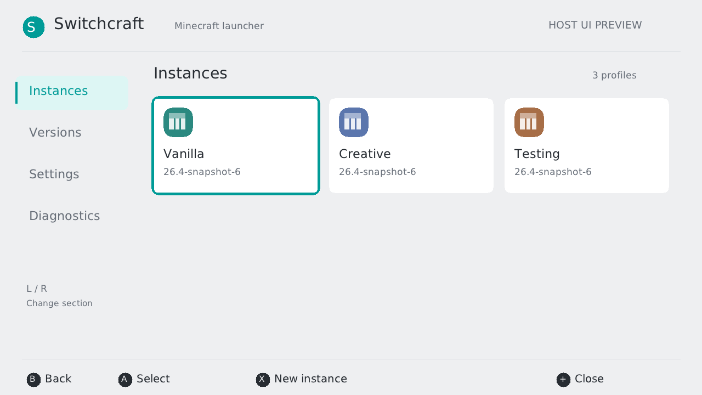
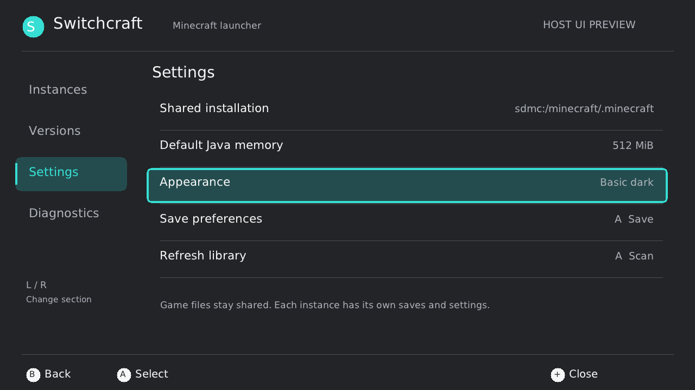

# Prism backend port and Switch launcher foundation

The first built milestone is available in the
[launcher artifact branch](https://github.com/a1c7e0/switchcraft/tree/artifacts/launcher-2041fe3).
Its ZIP can be merged onto the SD card after the existing Java25 diagnostic
package; diagnostic binaries, runtime images and user profiles are preserved.

Switchcraft adapts Prism Launcher's instance/component model and metadata
algorithms from immutable upstream commit
`059e858e101edc9314ccb94aa48bd01b282539c5`. The first portable backend is in
`src/prism_metadata.cpp`; original source files, hashes and attribution are in
[vendor/prism/PROVENANCE.md](../vendor/prism/PROVENANCE.md).

This is a first backend port, not the complete Qt application. Prism's QObject
models, network/task framework, account flow, mod platforms and full dependency
installer do not build directly against libnx. The current adaptation keeps
those unsupported operations explicit rather than supplying successful stubs.

## Implemented behavior

* Prism `instance.cfg` and `mmc-pack.json` profiles, with an isolated `.minecraft`
  directory for each instance and shared read-only versions/libraries/assets.
* Create, rename, edit version/memory, and duplicate profile settings without
  copying worlds, saves, assets or game configuration.
* Cached Prism package indexes sorted by UTC release timestamps, component
  dependencies with exact/suggested cached versions, conflicts and cycles.
* Ordered vanilla/`org.lwjgl3` component metadata and local patch overrides,
  Maven library replacement, main JAR paths, Java compatibility and JVM options.
* Real snapshot-6 metadata validation; legacy arguments retain the explicit
  Vulkan selection. Account placeholders remain unresolved, and game launch
  remains blocked on the actual runtime/native requirements.
* A PC metadata-cache helper that verifies Prism's indexed SHA-256 before
  publishing version JSON. It downloads metadata, not game payloads or assets.

Unknown component types, unsupported patch operations, malformed INI syntax,
missing cache entries and unsupported traits produce errors or launch blockers.
This does not establish arbitrary Prism instance/modpack compatibility. There
is no account login, on-console online installer, mod manager or game launch in
this milestone. Existing owned vanilla installation metadata remains supported
through the original read-only planner.

## UI and controls

The launcher uses an original 1280x720 interface with focus borders, large rows,
light/dark themes, controller hints, touch targets and the system software
keyboard. Theme selection initially follows the system setting when available.
System fonts are read through `pl:u` and never distributed with the project.
The UI is drawn through a libnx software framebuffer; the game's SDL3/Vulkan
architecture is unchanged and no OpenGL/EGL dependency is added. If the shared
font or framebuffer cannot initialize, the existing console inspector is used.
Both graphics paths remain **Horizon hardware NOT TESTED**.

| Control | Action |
| --- | --- |
| L / R | Change Instances, Versions, Settings and Diagnostics section |
| D-pad / held D-pad | Move focus; Left/Right changes version or memory in editors |
| A | Select/open; on a name field opens the system keyboard |
| B | Back; editing changes are discarded unless explicitly saved |
| X on Instances/Versions | New instance |
| + | Close launcher |
| Touch | Select a row/card; tap the selected item again to activate; footer buttons work |

Instance details offer installation checks, editing, settings-only duplication
and launch status. Checking an instance does not run game code. A on the check
report exports the complete `launch-plan.json`; failures remain in
`minecraft-launcher.log`. Diagnostics opens the existing independent NROs; VM
sessions still require fresh application processes.





The previews render the same canvas/screen code used by the NRO, with an ordinary
host font and clearly identified display fixtures. They are **HOST UI PREVIEW**,
not proof of Horizon UI, touch, font or applet execution.

## Cache metadata and import files

On a PC with Python 3, choose a new staging directory:

```sh
python3 tools/prism-cache.py --root /path/to/staging --version 26.4-snapshot-6
```

The helper fills `staging/meta/net.minecraft/` and required component directories
such as `meta/org.lwjgl3/`. Copy the resulting `meta/` directory into the shared
installation folder selected in Settings (default
`sdmc:/minecraft/.minecraft`). It does not download a runnable installation.
Bring your own game JARs/libraries/assets, using the paths reported by the
installation check; do not send them with test feedback.

Existing compatible Prism profile folders can be copied under
`sdmc:/switch/mc-runtime/instances/<safe-id>/`, keeping `instance.cfg`,
`mmc-pack.json`, local `patches/` and `.minecraft/` intact. The supported instance
INI subset accepts ordinary scalar Prism settings; unsupported syntax is
preserved and refused for edits. No automatic ZIP import or deletion is offered.
Back up profiles before changing versions. Each metadata file is staged and
flushed before rename; two-file changes are not atomic across sudden power loss.

Settings writes are explicit. Shared Minecraft installation data is never
rewritten by instance management or plan generation. Configurations rejected as
malformed are retained. The existing test package's `java-smoke` directory is
not treated as a launcher instance.

## Reproduce UI previews and host checks

```sh
make build/switchcraft-inspect build/launcher-preview
python3 -m unittest tests.test_metadata tests.test_instances tests.test_prism_metadata tests.test_prism_cache tests.test_ui_canvas -v
build/launcher-preview /path/to/font.ttf preview.ppm instances
build/launcher-preview /path/to/font.ttf dark.ppm settings dark
```

`launcher-preview` uses original in-memory display fixtures and writes PPM; it
runs neither Minecraft nor Horizon. A real Prism-service cache was also tested
through profile creation and Java25/Vulkan plan generation, with game launch
correctly false. This is host integration evidence only.

With the pinned SDK already prepared, `make launcher-package` cross-builds and
packages just this launcher milestone under `dist/launcher-foundation/`. The
packager requires a clean committed source tree and a matching final build ID.
The overlay ZIP replaces only the launcher and adds its documentation, licenses
and current source. Existing diagnostic NROs/runtime images remain those from
the separately published Java25 test package; their source/hash identity is not
relabeled as the new launcher revision.

First hardware UI checks: open in application-mode hbmenu; check readable font,
light/dark appearance, D-pad/stick repeat, shoulder sections and touch targets;
create an instance from a cached/installed version; reopen and verify its name,
version and memory; rename/edit, duplicate and confirm the duplicate game folder
is empty; export a readiness report; open an existing diagnostic NRO. Check
that a malformed profile remains intact and that the fallback inspector opens
if shared-font/framebuffer initialization fails. Export the appended launcher
log and review any plan JSON separately. All of these remain NOT TESTED on
Horizon; host canvas/metadata tests do not satisfy them.

## Licensing and source

The launcher links the adapted GPL-covered Prism code, so distribute this combined
launcher under GPL-3.0-only, retaining the applicable Apache-2.0 and other
third-party notices and providing its corresponding source. Original Switchcraft
MIT source retains its license; independent diagnostics do not acquire Prism
code through this change. Full texts are `licenses/PRISM-GPL-3.0.txt` and
`licenses/PRISM-APACHE-2.0.txt`. The portable font rasterizer is pinned in
`licenses/STB-TRUETYPE.txt`. No Nintendo UI assets/fonts, Minecraft binaries,
credentials or account files are included in source or preview fixtures.
